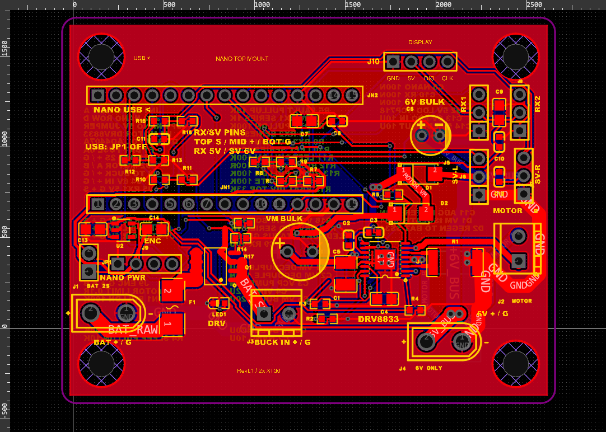

# 单桨双舵水面航行器控制板

Arduino Nano 插接式船控板，集成 DRV8833 有刷电机驱动、双舵机接口、编码器输入和四位数码屏接口。使用一块外接降压模块供电，保留原配遥控器与接收机，通过编码器反馈调节单桨电机转速。

[English overview](README.en.md) · [完整使用教程](docs/user-guide.md) · [完整接线](docs/wiring.md) · [焊接与上电](docs/assembly.md) · [两代方案对比](docs/comparison.md)

**[嘉立创开源工程：原理图、PCB 与 BOM](https://oshwhub.com/eda_jmihncbf/project_mhcxpkbn)**。已于 2026-11-09 提交开源，平台提示等待后台审核；页面暂不可访问时，可先下载下方 ZIP 或本仓库原生工程。

**[下载完整 ZIP 资料包](docs/downloads.md)**。解压后打开 `START_HERE.html`，可离线查看接线使用 PDF、焊接教程、原生工程和程序。



## 当前版本

| 项目 | 当前内容 |
| --- | --- |
| 硬件 | RevL1 J4 丝印修正版，69 × 54 mm，四个 Ø3.5 mm 固定孔 |
| 主控 | 经典 Arduino Nano，ATmega328P，5 V / 16 MHz，通过两排排母插接 |
| 电机驱动 | DRV8833PWPR，板载，双桥并联驱动单个有刷电机 |
| 样机电机 | GA25-370-0660-EN，6 V，减速比 9.6∶1 |
| 转向 | 左右双舵面，Nano 分别输出两路舵机信号，同向联动 |
| 样机舵机 | 两只角度定位型 SG90，实际电压与行程按所购型号确认 |
| 电源 | 2S 锂电池 → 主板保护 → 单块外接 6.0 V 降压模块 → 主板 |
| 显示 | CLK / DIO 四位数码管模块，固件内置驱动，免额外显示库 |
| 正常固件 | V5.4，目标 595 r/min，总电源开关启停，CH1 遥控转向 |
| 历史方案 | L298N 模块、单舵机、开环遥控油门，完整保留在 legacy |

## 从哪里开始

1. 从 [完整使用教程](docs/user-guide.md) 开始。在 [嘉立创工程页](https://oshwhub.com/eda_jmihncbf/project_mhcxpkbn) 查看设计，或在专业版导入 [原生工程](hardware/revl1/boat-controller-revl1.epro2)，核对当前版本的原理图与 PCB。
2. 查阅 [板上 BOM](hardware/revl1/bom.csv)、[外部模块清单](hardware/external-parts.csv) 和 [机械尺寸](hardware/mechanical.md)。
3. 按 [装配说明](docs/assembly.md) 检查芯片方向、底部散热盘、供电极性和 Nano 安装方向。
4. 按 [接线表](docs/wiring.md) 连接接收机、双舵、编码器与显示屏。
5. 打开 [V5.4 单文件程序](firmware/Boat_Nano_595_Display600/Boat_Nano_595_Display600.ino)，选择经典 Nano / ATmega328P 上传。

## 当前固件行为

- 接收机 CH1 有效且连续稳定约 0.5 秒后自动启动，内部转速目标约 2 秒爬升到 595 r/min。
- CH1 控制两只舵机，CH2 不参与这版程序的油门控制。左右脉宽默认 600～2400 μs，需按实际舵机和连杆调整端点。
- 编码器按 1019 个 A 相上升沿 / 10 个减速输出轴转数换算，假设输出轴到桨轴平均传动比为 1∶1。
- **V5.4 普通数字显示封顶 600。真实转速超过 600 时仍可能显示 600，控制反馈、串口 RPM 和超速判断使用原始数值。显示封顶值不能用于确认真实峰值。**
- 原始反馈达到 610 r/min 触发 E002 停机。595 是控制目标，实际可能有瞬时超调。
- 编码器异常、驱动故障、运行中转向失联等会锁定停机，处理原因后需要断电重启。

更多参数和 E001～E004 的定义见 [固件说明](docs/firmware.md)。

## 工程状态

最近保存的 RevL1 原生 PCB DRC 为 0 个违规，记录日期为 2026-10-21。现有证据覆盖 51 个元件、160 个焊盘网络和保存后的回读核查。归档包已检查 ZIP 完整性，尚未完成独立环境中的导入还原验证。

本仓库提供可编辑原生工程。Gerber、贴片坐标和下单文件应从核对后的工程导出。**J1/J4 的 XT30 插脚匹配仍有实物反馈待核实**，复刻前请先看 [已知问题](docs/known-issues.md)。

软件已完成经典 Nano 编译与假设电机模型回归。模型结果、样机读数、温升与额定电流能力分别记录在 [验证范围](docs/verification.md)。

## 仓库结构

```text
hardware/                  原生工程 BOM 机械尺寸与 DRC 记录
firmware/                  V5.4 正常程序与临时 PWM 诊断程序
docs/                      接线 装配 对比 故障与验证说明
legacy/l298n-single-servo/  早期方案原程序和文档
LICENSE                    MIT 许可证
THIRD_PARTY.md             外部库与器件资源说明
```

## 许可证

项目原创设计内容、代码和文档按 [MIT License](LICENSE) 发布。第三方器件库、库图形、商标及外部依赖的权利和许可见 [THIRD_PARTY.md](THIRD_PARTY.md)。
